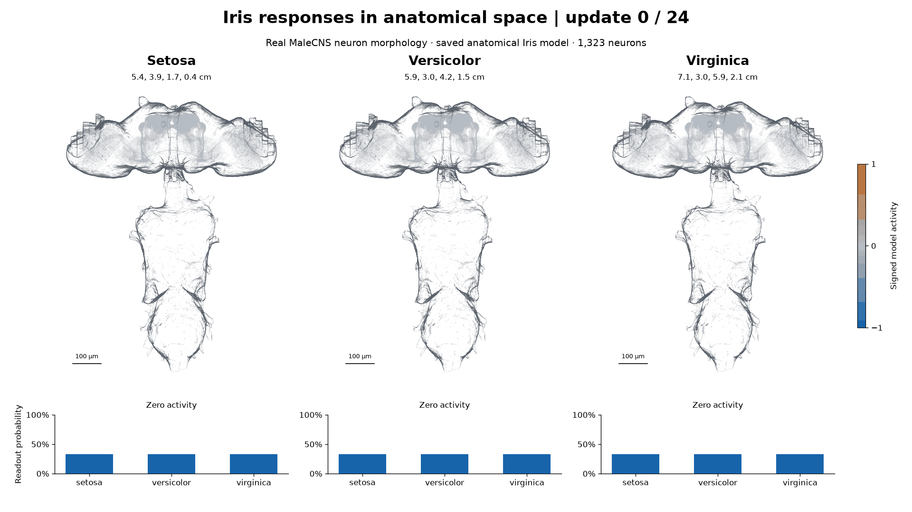

# Supervised Learning Through Synaptic Adaptation in a Drosophila Connectome Model for Classification and Regression

Research code for supervised adaptation of internal synaptic gains in a model of the MaleCNS *Drosophila* connectome. Experiments cover Iris species classification, regression of floral measurements, and Ki-67 prediction in breast cancer histopathology. BRAP-Net combines a frozen vision transformer (ViT) with the connectome model. In the frozen-feature experiments, task-specific learning adjusts internal gains while the visual extractor and input/output interfaces remain fixed. Additional comparisons evaluate traditional classifiers and exploratory joint fine-tuning of Phikon-v2 with anatomical gains or a linear output layer.

## Iris inference in anatomical space



The trained connectome model classifies one held-out flower from each Iris species over 24 recurrent updates. Colors show simulated neuron activity, and the bars show class probabilities. Synaptic gains remain fixed during inference.

[View or download the MP4](assets/iris-anatomical-activity.mp4).

Anatomical geometry: FlyEM Project Team at HHMI Janelia, Cambridge Connectomics Group, and Google Research ([MaleCNS v1.0](https://male-cns.janelia.org/download/), [CC BY 4.0](https://creativecommons.org/licenses/by/4.0/)). Geometry was converted and simplified for display and colored by simulated activity.

## Getting started

Clone the repository, then run commands from its root in Bash (Linux or WSL2):

```bash
git clone https://github.com/BioAITeam/drosophila-connectome-classification-regression.git
cd drosophila-connectome-classification-regression
```

1. [Install the environment](<1 Environment/README.md>).
2. [Restore the trained models](<4 Trained Models/README.md>): place the companion `zenodo.zip` archive in the repository root and extract it here. The resulting path must be `zenodo/payload/`. Follow that guide to create and verify the artifact links.
3. Predict new samples with the [Iris scripts](<5 Iris/4 Inference/README.md>) or [BRAP-Net image scripts](<6 Ki67/3 Inference/README.md>). Both workflows use CPU and saved weights.
4. [Reconstruct Figures 1-13 and Tables 1-16](<7 Paper Results/README.md>) from the archived evidence.

Inference and figure/table reconstruction use the restored artifacts; original image datasets are unnecessary. BRAP-Net inference takes the images you supply. To retrain from images or rebuild graphs from source, follow the [data guide](<2 Data/README.md>) before the corresponding experiment guide.

## Folder guide

| Folder | Read for |
| --- | --- |
| [1 Environment](<1 Environment/README.md>) | Installation, dependency versions and interpreter selection |
| [2 Data](<2 Data/README.md>) | Data sources, expected layouts and dataset specifications |
| [3 Connectome](<3 Connectome/README.md>) | Shared model implementation and anatomical graph construction |
| [4 Trained Models](<4 Trained Models/README.md>) | Restoring Zenodo, finding checkpoints and their dependencies |
| [5 Iris](<5 Iris/README.md>) | Iris classification, regression, inference and training |
| [6 Ki67](<6 Ki67/README.md>) | BRAP-Net inference and Ki-67 experiments |
| [7 Paper Results](<7 Paper Results/README.md>) | Regenerating the paper's figures and tables |
| [8 Documentation](<8 Documentation/README.md>) | Scientific protocols, evaluation and supporting evidence |

Cite the study using [CITATION.cff](CITATION.cff).

## License

Original code, documentation and project-authored research artifacts are available under the [Noncommercial Research and Education License](LICENSE), which requires citation. Datasets, frozen ViT weights and other third-party materials retain their source terms.
